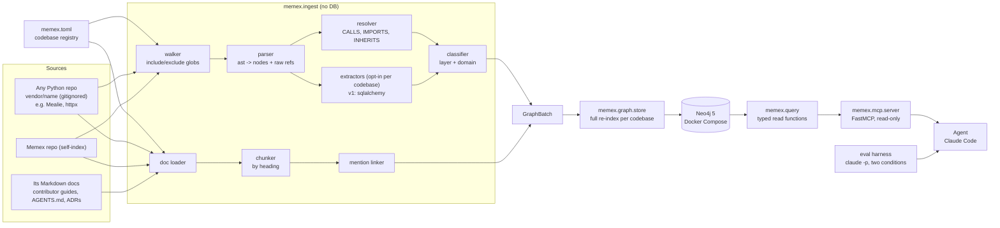

# Memex design

Status: approved in Phase 0. The graph schema and tool contract freeze after Phase 3; changes after that need an ADR in `docs/decisions/`.

## 1. Purpose

Memex is a general code knowledge graph for **any Python repository**: code structure plus the repo's engineering docs, exposed to AI agents through a read-only MCP server. It helps new engineers and coding agents understand unfamiliar code and check a proposed change against the team's own rules before making it.

Pointing Memex at a new repo means adding a section to `memex.toml` (often just `root` and `packages`) and running `memex index <name>`. No code changes.

## 2. Benchmark codebases

Real repos used to test and evaluate Memex. They are inputs, not part of the design: the external ones' names and conventions never appear in the `memex/` package (enforced by a test, section 12).

| Codebase | Why it is here | Pinned at | Config |
|---|---|---|---|
| **Mealie** | Primary benchmark and eval target: a layered FastAPI + SQLAlchemy app with real contributor docs and an `AGENTS.md`. Backend `mealie/` only; alembic migrations, tests and frontend excluded. | `v3.30.0`, commit `9552df62118224a377d9c9b0a62706a62220ab86` | Layer and domain rules, `sqlalchemy` extractor |
| **httpx** | Generality check: a differently shaped library (flat package, underscore-private modules, no web framework, no ORM) indexed with **zero rules and no extractors**. | `0.28.1`, commit `26d48e0634e6ee9cdc0533996db289ce4b430177` | Defaults only |
| **Memex** | Self-indexing, so Memex can explain its own design and ADRs. | working tree | Defaults only |

External repos are fetched by `scripts/fetch_codebases.py` into `vendor/<name>` (gitignored, never committed), using the `source`, `ref` and `commit` from `memex.toml`. The script refuses to continue if the checked-out commit does not match.

Runtime: Python 3.14. `ast` can only parse syntax its own interpreter version knows, so Memex runs on the newest Python any target uses (Mealie targets 3.14).

## 3. Architecture

Data flows in one direction through four packages:

- **`memex.ingest`** (pure Python, no database): walks files, parses them with `ast`, resolves references, runs opt-in framework extractors, classifies layer and domain, chunks docs, links mentions. Output: an in-memory `GraphBatch`.
- **`memex.graph`**: the graph model (frozen dataclasses) and the Neo4j store (writes, constraints, indexes).
- **`memex.query`**: typed read functions over Neo4j that return Pydantic models. All Cypher for reads lives here.
- **`memex.mcp`**: a thin FastMCP wrapper that registers `memex.query` functions as tools. No Cypher, no logic.

Because ingest never imports Neo4j, parsing and resolution are unit-testable without a database. Because the MCP layer holds no logic, every tool is testable as a plain function.



## 4. Generality principle

Memex works on any Python codebase. The core (walker, parser, resolver, classifier, store, query, mcp) contains nothing specific to any benchmark repo or web framework.

- Everything **repo-specific** lives in `memex.toml`.
- Everything **framework-specific** lives in an opt-in extractor under `memex/ingest/code/extractors/`.
- **Guardrail test:** fails if an external benchmark repo's name (`mealie`, `httpx`) appears anywhere in the `memex/` package, in any case, including comments and docstrings.
- **Proof on fixtures:** a plain fixture repo with no rules and no extractors is fully indexed by the defaults.
- **Proof on a real repo:** httpx is indexed with defaults only and has its own smoke tests (section 12).

## 5. Codebase registry (`memex.toml`)

Every codebase has a name, and every node carries a `codebase` property. Only `root` and `packages` are required; everything else is optional.

Paths: `root` is relative to `memex.toml`; `exclude`, `docs` and `doc_kinds` globs are relative to `root`; `layers` keys are relative to each package directory. Optional keys default to "no rules" (empty lists and tables, no domain normalization). `source`, `ref` and `commit` are set together or not at all, and unknown keys are an error.

Docs: `docs` globs match `.md` files only, and each file is read once. A glob that matches no Markdown file, or one outside `root`, is a config error. `exclude` applies to code only. A doc's kind is the label of the first `doc_kinds` glob, in table order, that matches its path; otherwise `doc`. A doc file that cannot be read or is not UTF-8 is recorded as a parse error and skipped.

```toml
[codebases.httpx]                  # minimal entry: defaults only
root = "vendor/httpx"
source = "https://github.com/encode/httpx"
ref = "0.28.1"
commit = "26d48e0634e6ee9cdc0533996db289ce4b430177"
packages = ["httpx"]
docs = ["README.md", "docs/*.md"]

[codebases.mealie]                 # entry with rules and an extractor
root = "vendor/mealie"
source = "https://github.com/mealie-recipes/mealie"
ref = "v3.30.0"
commit = "9552df62118224a377d9c9b0a62706a62220ab86"
packages = ["mealie"]
exclude = ["mealie/alembic/**", "**/tests/**", "frontend/**"]
docs = ["AGENTS.md", "docs/docs/contributors/**/*.md", "docs/docs/documentation/**/*.md"]
extractors = ["sqlalchemy"]

[codebases.mealie.layers]          # optional: folder path -> layer label
"routes" = "routes"
"services" = "services"
"repos" = "repos"
"db/models" = "db_models"
"schema" = "schema"

[codebases.mealie.domains]         # optional: name normalization
strip_prefixes = ["repository_", "controller_"]
strip_suffixes = ["_services", "_service"]
singularize = true

[codebases.mealie.doc_kinds]       # optional: docs glob -> label stored on Doc nodes
"AGENTS.md" = "agents"
"docs/docs/contributors/**" = "contributor"
"docs/docs/documentation/**" = "user"

[codebases.memex]                  # self-index: no code rules, no extractors
root = "."
packages = ["memex"]
exclude = ["tests/**", "vendor/**"]
docs = ["README.md", "DESIGN.md", "CLAUDE.md", "docs/decisions/*.md"]

[codebases.memex.doc_kinds]        # ADRs get their own kind
"docs/decisions/*.md" = "adr"
```

## 6. Framework extractors

Framework relationships sit behind one small interface in `memex/ingest/code/extractors/base.py`:

```python
class Extractor(Protocol):
    name: ClassVar[str]

    def extract(self, modules: Sequence[ParsedModule], symbols: SymbolTable) -> list[Edge]: ...

    def class_properties(
        self, modules: Sequence[ParsedModule], symbols: SymbolTable
    ) -> Mapping[str, Mapping[str, str]]: ...  # class id -> {property: value}
```

- `ParsedModule` holds a module's `ast` tree, path, qualname and the AST node of each definition.
- `SymbolTable` is the resolver's read-only lookup: by qualname, by short name, by class attribute such as `__tablename__`, base classes and ancestors, and how a module binds a name.
- Extractors only add edges between nodes that already exist, plus values for the class properties listed in `CLASS_PROPERTIES` (v1: `tablename`). They never create nodes or touch Neo4j.
- The registry dict `EXTRACTORS` in `extractors/__init__.py` maps names to extractor classes; the `extractors` list in `memex.toml` picks which ones run. An unknown name is a config error raised by `index_code` before anything is read.

**`sqlalchemy` (built in v1):** only calls that resolve to a name under `sqlalchemy` count, in assignments directly in a class body. `ForeignKey("users.id")` (also schema-qualified, or `ForeignKey(User.id)`) becomes a REFERENCES edge of kind `foreign_key` through the `__tablename__` lookup. `relationship(User)`, `relationship("User")`, a dotted string or `relationship(lambda: User)` becomes one of kind `relationship`. A string is resolved among mapped classes only (a class defining `__tablename__` as a string or a `@declared_attr` method, or one inheriting from such a class or from a `sqlalchemy` base), as the module binds it, then as a dotted name, then as a unique class name. An ambiguous or unknown target gives no edge. A class assigning a string to `__tablename__` gets the `tablename` property.

**`django` (documented, not built):** `models.ForeignKey(User, ...)`, `OneToOneField` and `ManyToManyField`, including string refs like `"auth.User"`, would become REFERENCES with kind `foreign_key`, `one_to_one` or `many_to_many`; `Meta.db_table` feeds the same table lookup. Adding it means one new file, one registry line and a small Django-shaped fixture, with no core changes.

## 7. Graph schema

Node ids are stable strings: `"{codebase}:{dotted.qualname}"` for code, `"{codebase}:ext:{dotted.name}"` for external names, `"{codebase}:doc:{path}#{anchor}"` for docs. Every node belongs to exactly one codebase.

### Nodes

| Label | Key properties |
|---|---|
| `Codebase` | name, root, source, ref, commit, indexed_at, extractors, files, parse_errors, unresolved_calls |
| `Module` | id, codebase, qualname, path, layer, domain, docstring (first line) |
| `Class` | id, codebase, name, qualname, path, line, end_line, layer, domain, docstring, tablename (when an extractor sets it) |
| `Function` | id, codebase, name, qualname, path, line, end_line, layer, domain, signature, is_method, is_async, docstring |
| `External` | id (e.g. `{codebase}:ext:pydantic.BaseModel`), codebase, name. Only for IMPORTS and INHERITS targets outside the codebase; never a CALLS target |
| `Doc` | id, codebase, path, heading_path (e.g. "Developers Guide > Database Changes"), anchor, text, start_line, end_line, kind (from `doc_kinds` in `memex.toml`, default `doc`) |

### Edges

| Edge | From -> To | Properties |
|---|---|---|
| `DEFINES` | Module -> Class/Function, Class -> Class/Function | |
| `IMPORTS` | Module -> Module/Class/Function/External | names, line |
| `CALLS` | Function -> Function | line, confidence (`exact`, `inferred`; `ambiguous` is stretch, see section 9) |
| `INHERITS` | Class -> Class/External | position |
| `REFERENCES` | Class -> Class | kind (`foreign_key`, `relationship`, ...), attr, line, extractor |
| `MENTIONS` | Doc -> Module/Class/Function | match (`qualname`, `path`, `backtick_name`) |

### Doc chunks and mentions

- **Chunks.** A doc is split at every ATX heading and every setext heading. A setext heading is a paragraph underlined with `===` or `---`, unless one of its lines starts a list item, quote, table row or HTML (which starts or interrupts the paragraph); its text is the whole paragraph. A chunk runs to the next heading of any level. Headings are never read inside fenced code, indented code, HTML comments or YAML front matter at the top of the file. Text before the first heading is a chunk with an empty anchor and heading_path. Only `\n`, `\r\n` and `\r` end a line.
- **Doc fields.** `anchor` is the heading's plain text: links reduced to their visible text; code span markers, emphasis markers and inline HTML dropped; whitespace collapsed. A heading repeated in one file gets ` (2)`, ` (3)` in its anchor only, so ids stay unique and match `path#Heading` references. `heading_path` joins the plain text of the enclosing headings and the chunk's own with ` > `. `text` is the body Markdown without the heading line. `start_line` is the heading's first line, and `end_line` the last non-blank line (1-based).
- **MENTIONS.** Found lexically in a chunk's source lines, heading line included. Each chunk gets one edge per target, with its strongest match:
  - `qualname`: a whole dotted name equal to a Module, Class or Function qualname, anywhere, code fences included.
  - `path`: a root-relative path naming a module file (`pkg/mod.py`) or a package directory (`pkg/`, `pkg/sub/`). Globs and URLs never match.
  - `backtick_name`: an inline code span, outside fences, holding a name, optionally followed by `()`. A bare name links only to the one Class or module-level Function with that name, never to a dunder, keyword, builtin or builtin type method name. Methods need the dotted form (`Class.method`), which links when exactly one Class or Function qualname ends with it.
  - Modules are never matched by a bare or dotted name. An ambiguous or unknown name gives no edge.
- The `Codebase` node's `parse_errors` counts code and doc files that failed; `files` counts code files.

### Neo4j setup

- Uniqueness constraint on `id` for each label.
- Index on `(codebase, name)` for Class, Function and External, and on `(codebase, qualname)` for Module, for symbol lookup.
- Full-text index `doc_text` on `Doc(heading_path, text)`.
- Re-index is per codebase and atomic: the batch is validated first (exactly one Codebase node for that codebase, every other id under the `{codebase}:` prefix, no duplicate ids, no dangling edges, no nodes of another codebase), then one write transaction deletes every node with that `codebase` and writes the batch with `UNWIND` in chunks of 1000. A failed re-index keeps the previous graph.
- Properties set to None are not stored; the model's `Edge.ref_kind` is stored as the REFERENCES property `kind`.

## 8. Layer and domain classification

Labels come from the folder structure, not from a hardcoded list.

**Default, when a codebase has no layer or domain rules:**
- Each top-level package in `packages` is a boundary; layers are never shared across packages.
- **Layer** is the first folder under the package root (`memex/ingest/...` gives `ingest`). Modules directly in the package root get layer `root`.
- **Domain** is the next folder under the layer folder (`memex/ingest/code/...` gives `code`). For a file directly in the layer folder, or in the package root, it is the file stem.
- One leading underscore is dropped from labels, because it marks "private" in Python, not a different area: in httpx, `_transports/asgi.py` gets layer `transports`, domain `asgi`, and `_client.py` gets layer `root`, domain `client`.
- `__init__.py` is labeled as its directory: `pkg/__init__.py` gets layer `root`, `pkg/routes/__init__.py` gets layer `routes` with no domain, and `pkg/routes/users/__init__.py` gets domain `users`. Other dunder files lose both underscore pairs (`__version__.py` gives `version`).
- No other renaming and no singularizing, so every label is a folder or file name and always explainable.

**With rules** (`[codebases.X.layers]`, `[codebases.X.domains]`):
- The layer map lets a multi-segment path (`db/models`) count as one layer with its own label.
- Domain rules are applied in order: drop the underscores as above, strip the first matching prefix, strip the first matching suffix, then singularize (`-ies` becomes `-y`, a trailing `-s` is dropped except after `s`, `u` or `i`, and words ending in `-ics` are kept). These are generic options that any repo can use; for example, in Mealie's config they make `routes/groups`, `schema/group` and `services/group_services` all become `group`, and the flat `repos/repository_recipes.py` becomes `recipe`.
- Folders not in the map fall back to the default rule, so nothing is silently dropped.

The index summary prints the layer and domain distribution so mislabels are visible. Known imperfect cases in the benchmark repos (for example Mealie's `meal_plan` vs `meals`) are documented, not hidden.

## 9. Call resolution

Best effort, with honest labels. Call sites count when they are inside a function body, including nested defs, lambdas and local classes (decorators and default values are evaluated outside the function and do not count). Each call site sees the names bound in the scopes around it. For each call site, in order:

1. A name defined locally in the module: `exact`.
2. An imported name (`from x import f`, at module level or inside the function): `exact`. Re-exports are followed, also to a name a codebase module re-exports from outside.
3. `self.x`, `cls.x`, `cls()`, `super().x`, `super(C, self).x`, `C.x` and `C(...).x` where `C` is a class in the codebase: the class (for `super()`, the bases of the method's class or of `C`), then its in-codebase bases depth first: `exact`. `super()` inside a class nested in a method, or with no enclosing class node, is unresolved.
4. `alias.x` or `alias.sub.x` where `alias` is an imported module: `exact`.
5. Otherwise, a function or method name that is unique in the codebase: `inferred`. Never for dunder names, names of builtin type methods (`add`, `pop`, `encode`, `get`, ...), a `super()` call, or a bare name bound inside the function or by the module (an assignment, or an import the resolver cannot place).
6. Otherwise, no edge. The unresolved count is recorded per codebase.

- Calling a class runs its `__init__`, found through its bases. A class with no `__init__` in the codebase gives no edge and is not counted as unresolved.
- A call rooted at a builtin, a literal or a name from outside the codebase (including `super()` reaching an outside base) is external: no edge, not counted.
- Call sites with the same caller and callee share one edge: the first call site's line, `exact` over `inferred`.

Base classes are resolved as the module binds them before the class binds its own name, so `class Base(Base)` and `class Repo(Repo[int])` inherit from the imported class.

Stretch: store 2 to 3 candidates as `ambiguous` edges, hidden by default and shown with `include_ambiguous=True`.

Known weak spot: calls through attributes whose type is only known at runtime, such as `self.repos.recipes.get_one(...)` (a common pattern in apps that inject repositories or services), need type information to resolve, so they are usually `inferred` or unresolved. Section 13 states this as a v1 limit.

## 10. MCP tools

Built with FastMCP. All tools are read-only and return Pydantic models, defined in `memex/query/models.py` and frozen by ADR-001. Models are immutable and reject unknown fields. List results carry `truncated: bool`. Results contain locations, signatures and first docstring lines, never source bodies; code is referred to by qualname.

**Scope rule:** every tool except `list_codebases` takes `codebase: str` as a required argument, which must be registered in `memex.toml` and indexed. An unknown codebase returns an error listing the registered names; a registered one that is not indexed returns an error naming `memex index`. `list_codebases` lists only codebases that are both. Memex never infers scope.

**Symbol rule:** `symbol` accepts a full qualname or its last dotted segments (`get_one`, `Client.get`); segments match whole, so `Repository` does not match `UserRepository`. An exact qualname wins. If several symbols match, the tool returns `symbol=None` and the candidates (ordered by qualname, at most `limit`, with `truncated`) instead of guessing; if nothing matches, both are empty.

**Arguments and size:** `limit` is 1 to 200 and `depth`/`max_depth` 1 to 5; anything else, or an empty name or query, or a doc query over 500 characters, is a tool error with the reason. Defaults are set so the JSON an agent receives stays under 4 KB per call. This is measured, not guaranteed by the code: it is checked on the fixtures and on Mealie (the largest measured, `impact_of` on a central class, is about 3.7 KB at its default of 8), and a repo with much longer qualnames could exceed it.

```python
list_codebases() -> CodebaseList
    # name, source, ref, commit, indexed_at, node counts by label,
    # edge counts by type, extractors, parse_errors

find_symbol(codebase: str, name: str,
            kind: Literal["module", "class", "function", "any"] = "any",
            limit: int = 10) -> SymbolSearch
    # best first: exact qualname, qualname ending with `name`, then last
    # segment containing `name` ignoring case; ties by qualname

callers(codebase: str, symbol: str, depth: int = 1, limit: int = 12) -> CallGraph
callees(codebase: str, symbol: str, depth: int = 1, limit: int = 12) -> CallGraph
    # breadth first; each function once, at its shortest distance, with the
    # via, line and confidence of the edge it was reached by; a recursive
    # function is its own caller and callee. A class stands for its own
    # __init__; a class that only inherits __init__, and a module, have no calls

impact_of(codebase: str, symbol: str, max_depth: int = 3, limit: int = 8) -> Impact
    # reverse traversal over CALLS, INHERITS, REFERENCES and IMPORTS from the
    # symbol and everything it DEFINES; modules are leaves (their importers are
    # not followed); the closest `limit` dependents grouped by layer, each with
    # distance and edge path; `total` counts all; up to 5 docs that MENTION the
    # symbol or a dependent: those on the symbol itself first, then on its members,
    # then by the closest dependent; each lists only mentions in the impact set.
    # `truncated` is set when dependents, candidates or docs were cut

search_docs(codebase: str, query: str, limit: int = 5) -> DocSearch
    # full-text hits on heading_path and text, by score: path, heading_path,
    # kind, line range, a snippet of at most 200 characters around the first
    # whole-word match, mentioned symbols; the query is plain text (Lucene
    # syntax is escaped), at most 500 characters

check_change(codebase: str, proposal: ChangeProposal) -> ChangeCheck

module_summary(codebase: str, module: str) -> ModuleSummary    # stretch
    # layer, domain, docstring, classes (bases, method names),
    # functions (signatures), internal imports, imported_by count, docs
```

### check_change

- `ChangeProposal`: `description: str` (plain text, not empty, at most 500 characters), `symbols: list[str] = []`. Explicit symbols (stripped, empty ones skipped) are preferred; if none, code-shaped names in the description are matched against the graph: a backtick span holding a dotted name (a trailing `()` dropped), and elsewhere dotted names whose segments have two characters or more, names with an underscore and CamelCase names. File names and hosts (`main.py`, `github.com`) and acronym plurals (`APIs`) are skipped. At most 10 names, in order of appearance.
- `ChangeCheck`: `resolved_symbols`, `ambiguous` (short names matching several symbols, never guessed: at most 3 candidates per name and 8 across all names; a name past that total is listed with no candidates), `unresolved`, `affected` (dependents counted by layer, None last, from one `impact_of` walk at depth 3 from all resolved symbols), `guidelines: list[Guideline]`, `truncated` (names, candidates or guidelines were cut).
- `Guideline`: `stance` (`forbids`, `encourages`, `related`), `quote` (one sentence, at most 200 characters, centered on what matched), `citation` (path, heading_path, and the sentence's own start_line and end_line), `matched_on` (`mention`, `search`).
- **Sentences.** A section body is split into sentences with fenced code skipped and blockquote markers dropped. A blank line, a list item or a table row (a table is found by its separator row) starts a new unit, and a unit is split after `.`, `!` or `?` followed by a capital letter or a code span, possibly behind emphasis, a link bracket, a quote or a parenthesis, except after `e.g.` and `i.e.`.
- **Stance**, on whole words, ignoring case and emphasis markers, in this order: a negated requirement (`don't need to`, `do not need to`, `no need to`, `not required`, `not necessary`) gives `related`; `never`, `do not`, `don't`, `must not`, `should not`, `shouldn't`, `avoid` give `forbids`; `must`, `should`, `always`, `prefer` give `encourages`; anything else is `related`.
- **mention:** doc sections that MENTION a symbol in the walk (the resolved symbols, their members, their dependents) or a module enclosing a resolved symbol (its module and the packages above it, the top-level package excluded). Ranked as `impact_of` ranks docs, with enclosing modules ranked as members. A section gives the sentences that name a mentioned symbol, or, if none does, those with a stance. A class or function is named by its qualname, or by its last dotted segments inside a code span; a module by its qualname or file path, and a package also by its directory, with or without the trailing slash. A bare name must stand alone, not inside a longer name or path.
- **search:** the description on `doc_text`, top 5 sections; a section gives the sentences sharing a word of four letters or more with the description (not a number or a common English word).
- Sentences with a stance come first. A sentence found both ways is listed once, as a mention; at most 2 guidelines per section and 6 in all.

Decision (ADR-002): check_change does not call an LLM. Rules come from doc sections found by mention and by search, stance comes from the modal-verb rules above, and the calling agent makes the final judgment. This keeps the server deterministic, testable and cheap, and every claim carries a citation.

## 11. Folder layout

```
memex/
  config.py                    # load memex.toml into typed Codebase configs
  ingest/
    code/walker.py parser.py resolver.py classify.py
    code/extractors/__init__.py  # EXTRACTORS registry
    code/extractors/base.py    # Extractor Protocol
    code/extractors/sqlalchemy.py
    docs/loader.py chunker.py mentions.py
  graph/model.py               # Node, Edge, GraphBatch (frozen after Phase 3)
  graph/store.py               # Neo4j writes, constraints, indexes
  query/models.py              # Pydantic result models: the tool contract
  query/scope.py               # the scope rule: registered and indexed
  query/codebases.py symbols.py calls.py impact.py docs.py change.py
  query/rules.py               # check_change text rules: code names, sentences, stance
  mcp/server.py                # FastMCP tool registration only
  cli.py                       # memex index <codebase> | memex serve | memex stats <codebase>
scripts/fetch_codebases.py     # clones each external codebase in memex.toml at its ref, verifies commit
scripts/render_docs.py         # HTML views of the Markdown docs
docs/decisions/                # ADRs, ingested as Doc nodes
eval/questions.yaml config.toml run.py grade.py results/
tests/fixtures/layered_app/    # generic layered web app: routes, services, repos, ORM models, schemas
tests/fixtures/plainrepo/      # two packages, no rules, no extractors
tests/fixtures/docs/
tests/unit/ tests/integration/ tests/mcp/ tests/realrepo/
tests/conftest.py              # the session-scoped Neo4j testcontainer
docker-compose.yml memex.toml pyproject.toml .mcp.json
DESIGN.md CLAUDE.md DEVLOG.md README.md
```

Dependencies: `neo4j`, `fastmcp`, `pydantic`. Dev: `pytest`, `ruff`, `testcontainers[neo4j]`, `pyyaml`. The CLI uses stdlib `argparse`; three commands do not justify a framework.

## 12. Test strategy

- **`layered_app` fixture with known answers.** About 15 files of a generic layered web app, built to cover patterns common in real projects rather than any one repo: domain folders whose names differ by layer (`routes/users/` vs `services/user_services/`), a flat folder of per-domain files (`repos/repository_orders.py`), ORM models with `ForeignKey("users.id")` and `relationship("User")`, an underscore-private folder (`_base`), an injected attribute call (`self.repos.orders.get_one()`), a method name that is not unique, and an external base class. Tests assert exact node sets, edges and confidence labels.
- **`plainrepo` fixture for generality.** Two packages, no rules, no extractors. Tests assert the default layer and domain behavior, and that no REFERENCES edges exist without an extractor enabled. The classifier is tested with and without rules on the same paths.
- **Doc fixtures.** `tests/fixtures/docs/` holds chunker edge cases with known chunks and line ranges. The `layered_app` docs (an AGENTS.md, a guide and an ADR, each with its own kind) mention its symbols by qualname, path and backticks, next to near-misses that must not link: an ambiguous or common name, a glob, an excluded path, an unknown qualname. `plainrepo` has a README with no `doc_kinds`. `tests/fixtures/docs/rules.md` holds known sentences, line ranges and stances for check_change; its integration tests add doc sections by hand with known forbid, encourage, negated and heading-only rules.
- **Guardrail test** (default run): scans every file in the `memex/` package and fails if the name of any external codebase in `memex.toml` (one with a `source`, so `mealie` and `httpx` but not `memex`) appears in it, case-insensitive, including comments and docstrings.
- **Unit tests** (no DB, default run, about 2 seconds; the fetch-script tests use real git and take most of it): parser, resolver, extractors, classifier, chunker, mention linker, store rows, CLI.
- **Integration tests** (`-m neo4j`): store round-trip (Doc nodes and MENTIONS included, plus the `doc_text` full-text index) and every `memex.query` function against a session-scoped Neo4j testcontainer, so tests never touch the dev database (Neo4j Community has one user database).
- **MCP contract tests** (`-m neo4j`): the FastMCP in-memory client calls each tool and checks the tool list, read-only annotations, output schemas against the contract models, default limits, that each tool returns exactly what its query function returns, codebase validation, argument errors, ambiguous-name handling, that nothing writes, and a size budget (the JSON text sent to the agent under 4 KB at default limits).
- **Real-repo smoke tests** (`-m realrepo`, opt-in, need `vendor/` fetched). One test file per benchmark repo; the assertions are about that repo, the code under test is not.
  - Mealie (rules + extractor): zero parse errors; `RecipeModel` present with layer `db_models`, domain `recipe` and incoming REFERENCES; `routes/households/*` classified as layer `routes`, domain `household`; the AGENTS.md rule against editing generated types is a Doc of kind `agents` that MENTIONS resolved symbols; every doc cited in `eval/questions.yaml` is a Doc id.
  - httpx (defaults only): zero parse errors; `Client` and `AsyncClient` found by `find_symbol`; `Client.get` has `Client.request` among its callees; `_transports/asgi.py` gets layer `transports`, domain `asgi`; README and `docs/*.md` indexed with kind `doc`, and `` ## `Client` `` MENTIONS its class; no REFERENCES edges.
  - Tools on the real repos (`-m "neo4j and realrepo"`, need Docker too): each repo is indexed into the testcontainer and every tool is called through the MCP client. Mealie: `impact_of RecipeModel` finds its REFERENCES dependents in `db_models` and dependents in `repos`; `search_docs` finds the AGENTS.md generated-types rule first; `callers get_one` returns candidates, not a guess; `check_change` on three hand-written proposals (not the eval's) cites the AGENTS.md rules against instantiating `AppSettings()` (by mention) and editing other locales (by search), and the one encouraging `uv` (by search), each with its line; ten shared short names keep to the shared candidate cap; every call stays within the size budget. httpx: `find_symbol` finds `Client` and `AsyncClient` first; `Client.get` is an `exact` caller of `Client.request`; docs are searchable with kind `doc`; `check_change` on `Client.request` resolves it and counts its dependents with defaults only; every call stays within the size budget.
- **Evaluation** runs outside pytest (section 14).

## 13. v1 limits

Stated openly:
- Python only.
- One framework extractor (SQLAlchemy).
- Name-based call resolution with no type inference. Calls through injected attributes (`self.repos.x.get_one()`) whose method name is shared by several classes get no edge.
- Local names are not typed either: `with Client(...) as client: client.request()` and `client = Client(); client.request()` give no edge when the method name is shared (found in the Phase 5 live check: httpx's module-level `request()` is not a caller of `Client.request`).
- Functions and classes defined inside a function get no node of their own; their code counts as part of the enclosing function.
- Names are resolved at module scope: a base defined in a class body, a nested class called as `self.Inner()`, `cls(...).m()`, and a later outside import that shadows an earlier local class are not resolved as Python would.
- An outside name re-exported through a star import of an outside module is not followed.
- `sqlalchemy`: a `ForeignKey` inside a module-level `Table(...)` (an association table) has no class to start from and gives no edge.
- Full re-index only; incremental indexing comes later.
- `callers` of a class that only inherits `__init__` is empty: constructor calls are stored on the base's `__init__`, so they cannot be told apart from other subclasses' constructions.
- Symbol lookup filters on qualname suffixes without using an index; fine at the benchmark sizes (under 400 ms per tool call on Mealie, MCP round trip included).
- Doc mentions are found lexically; a bare word outside backticks never matches. A name inside a call written in backticks (`Depends(get_session)`) is not linked, and bare method names are not linked (section 7).
- Backtick spans are found outside fences only: a span inside an HTML comment or indented code still links, and a fence opened inside an HTML comment hides the spans after it. A code span that wraps across lines is not linked.
- The chunker reads only the block rules that decide headings:
  - HTML blocks other than comments are not recognized, and any paragraph whose line starts with `<` counts as HTML (`<3 our users` underlined is no heading).
  - Headings inside blockquotes or list items (`> ## Note`) are not detected.
  - A file whose first line is a `---` rule is read as front matter up to the next `---`.
- Anchors are reduced by pattern, not parsed:
  - Brackets are dropped as shortcut links even without a link definition (`Optional[str]` gives `Optionalstr`).
  - Angle brackets outside code are dropped as HTML (`<https://...>` and `Map<K, V>` vanish).
  - A link URL containing `)` leaves a stray `)`, and emphasis markers that span a code span stay.
  - `*args and **kwargs` loses markers, and backslash escapes and entities are kept as written.
  - A heading with no plain text gets an empty anchor, or ` (2)` after a preamble.
- Guideline stance comes from modal-verb rules, not semantic understanding.
- check_change reads doc text by pattern, not by parsing:
  - HTML comments and indented code are read as prose, so a rule inside them is quoted.
  - When a section's mention sits only in a fence, its sentences with a stance are quoted, as for a heading-only mention.
  - Search matching counts any shared word of four letters or more outside a short stopword list, so generic words (`change`, `code`, `file`) can pick a sentence.
  - Brand and product names in a description (`OAuth`, `FastAPI`) look like code names and are listed as unresolved.

## 14. Evaluation

- Runs on Mealie, the primary benchmark: it is large enough (about 415 backend files) that plain file search gets expensive, and it has real contributor rules for check_change. httpx is covered by smoke tests, not the eval.
- 12 questions with known answers, drafted in Phase 1 before the tools exist so they are not biased toward Memex. Answers come from exploration plus a manual check, never from Memex itself.
- Categories: 3 locate, 3 callers or dependents, 2 layer or domain, 2 doc rules, 2 check_change.
- Answers are set-valued (symbols, files, doc sections) so grading is deterministic: precision and recall against the expected set.
- Conditions, same model, prompt and working directory:
  - **A:** `Read`, `Grep`, `Glob` on `vendor/mealie`.
  - **B:** Memex MCP tools plus `Read`.
- `eval/run.py` calls `claude -p --output-format json` per question per condition with restricted tools, and records token usage (input, output and cache separately). Condition B pays for its tool definitions, and the report says so.
- `runs_per_condition` lives in `eval/config.toml`. It defaults to 1; with N=1 there is no variance estimate, and the results say so.

## 15. Build plan

Estimates include review time and assume phases run one after another.

| Phase | Est. | Work | Done means |
|---|---|---|---|
| 0. Workflow | 0.5 h | DESIGN.md, CLAUDE.md, DEVLOG.md, reviewer agent, lint hook. No app code. | Docs reviewed and edited; committed. |
| 1. Scaffold + exploration | 1.75 h | pyproject (uv, Python 3.14, ruff, pytest markers), docker-compose Neo4j 5 with healthcheck, `.gitignore`, `fetch_codebases.py` with commit check, `memex.toml` + `config.py`, guardrail test. Built-in Explore maps Mealie and drafts 12 eval questions. | `uv run pytest` green; Neo4j healthy; fetch yields Mealie `9552df6` and httpx `26d48e0`; `eval/questions.yaml` verified by hand. |
| 2. Parse + classify | 2 h | Both fixtures; walker; parser (Module, Class, Function, DEFINES, IMPORTS, External); classifier with defaults and rules. | Fixture tests assert exact nodes, edges and labels; Mealie and httpx parse with 0 errors; layer/domain reports for both sanity-checked. |
| 3. Resolve + extract + store | 3.25 h | Resolver (CALLS with confidence, INHERITS), Extractor Protocol + `sqlalchemy`, Neo4j store, `memex index`, `memex stats`. Freeze schema (ADR-001). | Fixture edge tests green; `plainrepo` has no REFERENCES; integration tests green; Mealie, httpx and Memex indexed; REFERENCES into `RecipeModel` look right; httpx smoke tests green with defaults only; reviewer pass. |
| 4. Docs (worktree) | 1.5 h | Loader, heading chunker, mention linker, full-text index, ADRs ingested. | Fixture doc tests green; Mealie's AGENTS.md rule about never editing generated types is searchable and MENTIONS resolved symbols; httpx docs are searchable with no `doc_kinds` config. |
| 5. Query + MCP (main) | 2.5 h | list_codebases, find_symbol, callers, callees, impact_of, search_docs; FastMCP server; `.mcp.json`; minimal README "how to run". | Query and MCP contract tests green; size budgets hold; "what depends on RecipeModel" works in a live Claude Code session, and the same tools answer httpx questions with no code change. |
| 6. check_change | 1.5 h | Proposal resolution, guideline retrieval, stance, citations; ADR-002. | Fixture tests with known forbid/encourage rules; 3 hand-written Mealie proposals return correct citations. |
| 7. Evaluation | 1.5 h | `eval/run.py`, `eval/grade.py`, results table. | 12 questions x 2 conditions run; raw JSON committed; DEVLOG records scores, tokens and losses honestly. |
| **Cut line** | **14.5 h** | Everything above is must-have for the demo. | |
| 8. Polish (stretch) | 0.5 h | README walkthrough, demo script, interview notes. | A fresh clone reaches a working MCP server by following the README. |
| 9. Stretch items | 0.5 h+ | Any of: `module_summary`, `ambiguous` call tier, eval with N=3, Django extractor fixture test. | Each item ships with its own tests. |
| **Total** | **~15.5 h** | The generality work (second repo, guardrail) added about 0.5 h. | |
