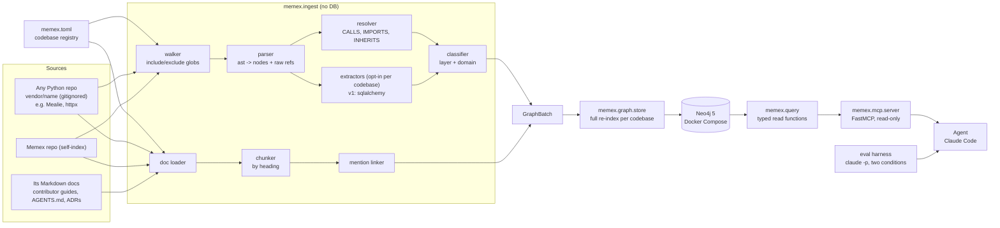

# Memex design

Status: approved in Phase 0. The graph schema and tool contract freeze after Phase 3; changes after that need an ADR in `docs/decisions/`.

## 1. Purpose

Memex is a general code knowledge graph for **any Python repository**: code structure plus the repo's engineering docs, exposed to AI agents through a read-only MCP server. It helps new engineers and coding agents understand unfamiliar code and check a proposed change against the team's own rules before making it.

Pointing Memex at a new repo means adding a section to `memex.toml` (often just `root` and `packages`) and running `memex index <name>`. No code changes.

## 2. Benchmark codebases

Real repos used to test and evaluate Memex. They are inputs, not part of the design: the external ones' names and conventions never appear in the `memex/` package (enforced by a test, section 12).

| Codebase | Why it is here | Pinned at | Config |
|---|---|---|---|
| **Mealie** | Primary benchmark and eval target: a layered FastAPI + SQLAlchemy app with real contributor docs and an `AGENTS.md`. Backend `mealie/` only; alembic migrations, tests and frontend excluded. | `v3.30.0`, commit `9552df62118224a377d9c9b0a62706a62220ab86` | Layer and domain rules, `sqlalchemy` extractor |
| **httpx** | Generality check: a differently shaped library (flat package, underscore-private modules, no web framework, no ORM) indexed with **zero rules and no extractors**. | `0.28.1`, commit `26d48e0634e6ee9cdc0533996db289ce4b430177` | Defaults only |
| **Memex** | Self-indexing, so Memex can explain its own design and ADRs. | working tree | Defaults only |

External repos are fetched by `scripts/fetch_codebases.py` into `vendor/<name>` (gitignored, never committed), using the `source`, `ref` and `commit` from `memex.toml`. The script refuses to continue if the checked-out commit does not match.

Runtime: Python 3.14. `ast` can only parse syntax its own interpreter version knows, so Memex runs on the newest Python any target uses (Mealie targets 3.14).

## 3. Architecture

Data flows in one direction through four packages:

- **`memex.ingest`** (pure Python, no database): walks files, parses them with `ast`, resolves references, runs opt-in framework extractors, classifies layer and domain, chunks docs, links mentions. Output: an in-memory `GraphBatch`.
- **`memex.graph`**: the graph model (frozen dataclasses) and the Neo4j store (writes, constraints, indexes).
- **`memex.query`**: typed read functions over Neo4j that return Pydantic models. All Cypher for reads lives here.
- **`memex.mcp`**: a thin FastMCP wrapper that registers `memex.query` functions as tools. No Cypher, no logic.

Because ingest never imports Neo4j, parsing and resolution are unit-testable without a database. Because the MCP layer holds no logic, every tool is testable as a plain function.



## 4. Generality principle

Memex works on any Python codebase. The core (walker, parser, resolver, classifier, store, query, mcp) contains nothing specific to any benchmark repo or web framework.

- Everything **repo-specific** lives in `memex.toml`.
- Everything **framework-specific** lives in an opt-in extractor under `memex/ingest/code/extractors/`.
- **Guardrail test:** fails if an external benchmark repo's name (`mealie`, `httpx`) appears anywhere in the `memex/` package, in any case, including comments and docstrings.
- **Proof on fixtures:** a plain fixture repo with no rules and no extractors is fully indexed by the defaults.
- **Proof on a real repo:** httpx is indexed with defaults only and has its own smoke tests (section 12).

## 5. Codebase registry (`memex.toml`)

Every codebase has a name, and every node carries a `codebase` property. Only `root` and `packages` are required; everything else is optional.

Paths: `root` is relative to `memex.toml`; `exclude`, `docs` and `doc_kinds` globs are relative to `root`; `layers` keys are relative to each package directory. Optional keys default to "no rules" (empty lists and tables, no domain normalization). `source`, `ref` and `commit` are set together or not at all, and unknown keys are an error.

```toml
[codebases.httpx]                  # minimal entry: defaults only
root = "vendor/httpx"
source = "https://github.com/encode/httpx"
ref = "0.28.1"
commit = "26d48e0634e6ee9cdc0533996db289ce4b430177"
packages = ["httpx"]
docs = ["README.md", "docs/*.md"]

[codebases.mealie]                 # entry with rules and an extractor
root = "vendor/mealie"
source = "https://github.com/mealie-recipes/mealie"
ref = "v3.30.0"
commit = "9552df62118224a377d9c9b0a62706a62220ab86"
packages = ["mealie"]
exclude = ["mealie/alembic/**", "**/tests/**", "frontend/**"]
docs = ["AGENTS.md", "docs/docs/contributors/**/*.md", "docs/docs/documentation/**/*.md"]
extractors = ["sqlalchemy"]

[codebases.mealie.layers]          # optional: folder path -> layer label
"routes" = "routes"
"services" = "services"
"repos" = "repos"
"db/models" = "db_models"
"schema" = "schema"

[codebases.mealie.domains]         # optional: name normalization
strip_prefixes = ["repository_", "controller_"]
strip_suffixes = ["_services", "_service"]
singularize = true

[codebases.mealie.doc_kinds]       # optional: docs glob -> label stored on Doc nodes
"AGENTS.md" = "agents"
"docs/docs/contributors/**" = "contributor"
"docs/docs/documentation/**" = "user"

[codebases.memex]                  # self-index: defaults only
root = "."
packages = ["memex"]
exclude = ["tests/**", "vendor/**"]
docs = ["README.md", "DESIGN.md", "CLAUDE.md", "docs/decisions/*.md"]
```

## 6. Framework extractors

Framework relationships sit behind one small interface in `memex/ingest/code/extractors/base.py`:

```python
class Extractor(Protocol):
    name: str

    def extract(self, modules: Sequence[ParsedModule], symbols: SymbolTable) -> list[Edge]: ...
```

- `ParsedModule` holds a module's `ast` tree, path and qualname.
- `SymbolTable` is the resolver's read-only lookup: by qualname, by short name, and by class attribute such as `__tablename__`.
- Extractors only add edges between nodes that already exist. They never create nodes or touch Neo4j.
- A registry dict maps names to extractor classes; the `extractors` list in `memex.toml` picks which ones run.

**`sqlalchemy` (built in v1):** `ForeignKey("users.id")` becomes a REFERENCES edge through the `__tablename__` lookup; `relationship("User")` or `relationship(User)` becomes a REFERENCES edge to that class.

**`django` (documented, not built):** `models.ForeignKey(User, ...)`, `OneToOneField` and `ManyToManyField`, including string refs like `"auth.User"`, would become REFERENCES with kind `foreign_key`, `one_to_one` or `many_to_many`; `Meta.db_table` feeds the same table lookup. Adding it means one new file, one registry line and a small Django-shaped fixture, with no core changes.

## 7. Graph schema

Node ids are stable strings: `"{codebase}:{dotted.qualname}"` for code, `"{codebase}:ext:{dotted.name}"` for external names, `"{codebase}:doc:{path}#{anchor}"` for docs. Every node belongs to exactly one codebase.

### Nodes

| Label | Key properties |
|---|---|
| `Codebase` | name, root, source, ref, commit, indexed_at, extractors, parse_errors |
| `Module` | id, codebase, qualname, path, layer, domain, docstring (first line) |
| `Class` | id, codebase, name, qualname, path, line, end_line, layer, domain, docstring, tablename (when an extractor sets it) |
| `Function` | id, codebase, name, qualname, path, line, end_line, layer, domain, signature, is_method, is_async, docstring |
| `External` | id (e.g. `{codebase}:ext:pydantic.BaseModel`), codebase, name. Only for IMPORTS and INHERITS targets outside the codebase; never a CALLS target |
| `Doc` | id, codebase, path, heading_path (e.g. "Developers Guide > Database Changes"), anchor, text, start_line, end_line, kind (from `doc_kinds` in `memex.toml`, default `doc`) |

### Edges

| Edge | From -> To | Properties |
|---|---|---|
| `DEFINES` | Module -> Class/Function, Class -> Function | |
| `IMPORTS` | Module -> Module/Class/Function/External | names, line |
| `CALLS` | Function -> Function | line, confidence (`exact`, `inferred`; `ambiguous` is stretch, see section 9) |
| `INHERITS` | Class -> Class/External | position |
| `REFERENCES` | Class -> Class | kind (`foreign_key`, `relationship`, ...), attr, line, extractor |
| `MENTIONS` | Doc -> Module/Class/Function | match (`qualname`, `path`, `backtick_name`) |

### Neo4j setup

- Uniqueness constraint on `id` for each label.
- Index on `(codebase, name)` for symbol lookup.
- Full-text index `doc_text` on `Doc(heading_path, text)`.
- Re-index is per codebase: delete every node with that `codebase`, then write in batches with `UNWIND`.

## 8. Layer and domain classification

Labels come from the folder structure, not from a hardcoded list.

**Default, when a codebase has no layer or domain rules:**
- Each top-level package in `packages` is a boundary; layers are never shared across packages.
- **Layer** is the first folder under the package root (`memex/ingest/...` gives `ingest`). Modules directly in the package root get layer `root`.
- **Domain** is the next folder under the layer folder (`memex/ingest/code/...` gives `code`). For a file directly in the layer folder, or in the package root, it is the file stem.
- One leading underscore is dropped from labels, because it marks "private" in Python, not a different area: in httpx, `_transports/asgi.py` gets layer `transports`, domain `asgi`, and `_client.py` gets layer `root`, domain `client`.
- `__init__.py` is labeled as its directory: `pkg/__init__.py` gets layer `root`, `pkg/routes/__init__.py` gets layer `routes` with no domain, and `pkg/routes/users/__init__.py` gets domain `users`. Other dunder files lose both underscore pairs (`__version__.py` gives `version`).
- No other renaming and no singularizing, so every label is a folder or file name and always explainable.

**With rules** (`[codebases.X.layers]`, `[codebases.X.domains]`):
- The layer map lets a multi-segment path (`db/models`) count as one layer with its own label.
- Domain rules are applied in order: drop the underscores as above, strip the first matching prefix, strip the first matching suffix, then singularize (`-ies` becomes `-y`, a trailing `-s` is dropped except after `s`, `u` or `i`, and words ending in `-ics` are kept). These are generic options that any repo can use; for example, in Mealie's config they make `routes/groups`, `schema/group` and `services/group_services` all become `group`, and the flat `repos/repository_recipes.py` becomes `recipe`.
- Folders not in the map fall back to the default rule, so nothing is silently dropped.

The index summary prints the layer and domain distribution so mislabels are visible. Known imperfect cases in the benchmark repos (for example Mealie's `meal_plan` vs `meals`) are documented, not hidden.

## 9. Call resolution

Best effort, with honest labels. For each call site, in order:

1. A name defined locally in the module: `exact`.
2. An imported name (`from x import f`): `exact`.
3. `self.x` or `cls.x`: the enclosing class, then its in-codebase bases: `exact`.
4. `alias.x` where `alias` is an imported module: `exact`.
5. Otherwise, a function or method name that is unique in the codebase: `inferred`.
6. Otherwise, no edge. The unresolved count is recorded per codebase.

Stretch: store 2 to 3 candidates as `ambiguous` edges, hidden by default and shown with `include_ambiguous=True`.

Known weak spot: calls through attributes whose type is only known at runtime, such as `self.repos.recipes.get_one(...)` (a common pattern in apps that inject repositories or services), need type information to resolve, so they are usually `inferred` or unresolved. Section 13 states this as a v1 limit.

## 10. MCP tools

Built with FastMCP. All tools are read-only and return Pydantic models. List results carry `truncated: bool`. Results contain locations, signatures and first docstring lines, never source bodies.

**Scope rule:** every tool except `list_codebases` takes `codebase: str` as a required argument, validated against the registry. An unknown codebase returns an error listing the registered names. Memex never infers scope.

**Symbol rule:** `symbol` accepts a full qualname or a short name. If a short name matches more than one symbol, the tool returns the candidates instead of guessing.

```python
list_codebases() -> CodebaseList
    # name, source, ref, commit, indexed_at, node counts by label,
    # edge counts by type, extractors, parse_errors

find_symbol(codebase: str, name: str,
            kind: Literal["module", "class", "function", "any"] = "any",
            limit: int = 20) -> SymbolSearch

callers(codebase: str, symbol: str, depth: int = 1, limit: int = 50) -> CallGraph
callees(codebase: str, symbol: str, depth: int = 1, limit: int = 50) -> CallGraph

impact_of(codebase: str, symbol: str, max_depth: int = 3, limit: int = 100) -> Impact
    # reverse traversal over CALLS, INHERITS, REFERENCES and IMPORTS;
    # dependents grouped by layer, each with distance and edge path;
    # plus docs that MENTION any dependent

search_docs(codebase: str, query: str, limit: int = 10) -> DocSearch
    # full-text hits: path, heading_path, line range, snippet, mentioned symbols

check_change(codebase: str, proposal: ChangeProposal) -> ChangeCheck

module_summary(codebase: str, module: str) -> ModuleSummary    # stretch
    # layer, domain, docstring, classes (bases, method names),
    # functions (signatures), internal imports, imported_by count, docs
```

### check_change

- `ChangeProposal`: `description: str`, `symbols: list[str] = []`. Explicit symbols are preferred; if empty, identifiers in the description are matched against the graph.
- `ChangeCheck`: `resolved_symbols`, `unresolved`, `affected` (an `Impact` summary by layer), `guidelines: list[Guideline]`.
- `Guideline`: `stance` (`forbids`, `encourages`, `related`), `quote` (the sentence), `citation` (path, heading_path, start_line, end_line), `matched_on` (`mention`, `search`).

Decision (ADR-002, written in Phase 6): check_change does not call an LLM. It retrieves candidate rules from docs that mention the affected symbols, modules or layers, plus a full-text search on the description, and assigns stance with transparent modal-verb rules (`never`, `do not`, `must not`, `avoid` give `forbids`; `must`, `should`, `always`, `prefer` give `encourages`). The calling agent makes the final judgment. This keeps the server deterministic, testable and cheap, and every claim carries a citation.

## 11. Folder layout

```
memex/
  config.py                    # load memex.toml into typed Codebase configs
  ingest/
    code/walker.py parser.py resolver.py classify.py
    code/extractors/base.py    # Extractor Protocol + registry
    code/extractors/sqlalchemy.py
    docs/loader.py chunker.py mentions.py
  graph/model.py               # Node, Edge, GraphBatch (frozen after Phase 3)
  graph/store.py               # Neo4j writes, constraints, indexes
  query/models.py              # Pydantic result models: the tool contract
  query/codebases.py symbols.py calls.py impact.py docs.py change.py
  mcp/server.py                # FastMCP tool registration only
  cli.py                       # memex index <codebase> | memex serve | memex stats <codebase>
scripts/fetch_codebases.py     # clones each external codebase in memex.toml at its ref, verifies commit
scripts/render_docs.py         # HTML views of the Markdown docs
docs/decisions/                # ADRs, ingested as Doc nodes
eval/questions.yaml config.toml run.py grade.py results/
tests/fixtures/layered_app/    # generic layered web app: routes, services, repos, ORM models, schemas
tests/fixtures/plainrepo/      # two packages, no rules, no extractors
tests/fixtures/docs/
tests/unit/ tests/integration/ tests/mcp/
docker-compose.yml memex.toml pyproject.toml
DESIGN.md CLAUDE.md DEVLOG.md README.md
```

Dependencies: `neo4j`, `fastmcp`, `pydantic`. Dev: `pytest`, `ruff`, `testcontainers[neo4j]`, `pyyaml`. The CLI uses stdlib `argparse`; three commands do not justify a framework.

## 12. Test strategy

- **`layered_app` fixture with known answers.** About 15 files of a generic layered web app, built to cover patterns common in real projects rather than any one repo: domain folders whose names differ by layer (`routes/users/` vs `services/user_services/`), a flat folder of per-domain files (`repos/repository_orders.py`), ORM models with `ForeignKey("users.id")` and `relationship("User")`, an underscore-private folder (`_base`), an injected attribute call (`self.repos.orders.get_one()`), a method name that is not unique, and an external base class. Tests assert exact node sets, edges and confidence labels.
- **`plainrepo` fixture for generality.** Two packages, no rules, no extractors. Tests assert the default layer and domain behavior, and that no REFERENCES edges exist without an extractor enabled. The classifier is tested with and without rules on the same paths.
- **Guardrail test** (default run): scans every file in the `memex/` package and fails if the name of any external codebase in `memex.toml` (one with a `source`, so `mealie` and `httpx` but not `memex`) appears in it, case-insensitive, including comments and docstrings.
- **Unit tests** (no DB, default run, under 2 seconds): parser, resolver, extractors, classifier, chunker, mention linker.
- **Integration tests** (`-m neo4j`): store round-trip and every `memex.query` function against a session-scoped Neo4j testcontainer, so tests never touch the dev database (Neo4j Community has one user database).
- **MCP contract tests** (`-m neo4j`): the FastMCP in-memory client calls each tool and checks the schema, codebase validation, ambiguous-name handling and a size budget (JSON under 4 KB at default limits).
- **Real-repo smoke tests** (`-m realrepo`, opt-in, need `vendor/` fetched). One test file per benchmark repo; the assertions are about that repo, the code under test is not.
  - Mealie (rules + extractor): zero parse errors; `RecipeModel` present with layer `db_models`, domain `recipe` and incoming REFERENCES; `routes/households/*` classified as layer `routes`, domain `household`.
  - httpx (defaults only): zero parse errors; `Client` and `AsyncClient` found by `find_symbol`; `Client.get` has `Client.request` among its callees; `_transports/asgi.py` gets layer `transports`, domain `asgi`; README and `docs/*.md` searchable; no REFERENCES edges.
- **Evaluation** runs outside pytest (section 14).

## 13. v1 limits

Stated openly:
- Python only.
- One framework extractor (SQLAlchemy).
- Name-based call resolution with no type inference.
- Functions and classes defined inside a function get no node of their own; their code counts as part of the enclosing function.
- Full re-index only; incremental indexing comes later.
- Doc mentions are found lexically.
- Guideline stance comes from modal-verb rules, not semantic understanding.

## 14. Evaluation

- Runs on Mealie, the primary benchmark: it is large enough (about 415 backend files) that plain file search gets expensive, and it has real contributor rules for check_change. httpx is covered by smoke tests, not the eval.
- 12 questions with known answers, drafted in Phase 1 before the tools exist so they are not biased toward Memex. Answers come from exploration plus a manual check, never from Memex itself.
- Categories: 3 locate, 3 callers or dependents, 2 layer or domain, 2 doc rules, 2 check_change.
- Answers are set-valued (symbols, files, doc sections) so grading is deterministic: precision and recall against the expected set.
- Conditions, same model, prompt and working directory:
  - **A:** `Read`, `Grep`, `Glob` on `vendor/mealie`.
  - **B:** Memex MCP tools plus `Read`.
- `eval/run.py` calls `claude -p --output-format json` per question per condition with restricted tools, and records token usage (input, output and cache separately). Condition B pays for its tool definitions, and the report says so.
- `runs_per_condition` lives in `eval/config.toml`. It defaults to 1; with N=1 there is no variance estimate, and the results say so.

## 15. Build plan

Estimates include review time and assume phases run one after another.

| Phase | Est. | Work | Done means |
|---|---|---|---|
| 0. Workflow | 0.5 h | DESIGN.md, CLAUDE.md, DEVLOG.md, reviewer agent, lint hook. No app code. | Docs reviewed and edited; committed. |
| 1. Scaffold + exploration | 1.75 h | pyproject (uv, Python 3.14, ruff, pytest markers), docker-compose Neo4j 5 with healthcheck, `.gitignore`, `fetch_codebases.py` with commit check, `memex.toml` + `config.py`, guardrail test. Built-in Explore maps Mealie and drafts 12 eval questions. | `uv run pytest` green; Neo4j healthy; fetch yields Mealie `9552df6` and httpx `26d48e0`; `eval/questions.yaml` verified by hand. |
| 2. Parse + classify | 2 h | Both fixtures; walker; parser (Module, Class, Function, DEFINES, IMPORTS, External); classifier with defaults and rules. | Fixture tests assert exact nodes, edges and labels; Mealie and httpx parse with 0 errors; layer/domain reports for both sanity-checked. |
| 3. Resolve + extract + store | 3.25 h | Resolver (CALLS with confidence, INHERITS), Extractor Protocol + `sqlalchemy`, Neo4j store, `memex index`, `memex stats`. Freeze schema (ADR-001). | Fixture edge tests green; `plainrepo` has no REFERENCES; integration tests green; Mealie, httpx and Memex indexed; REFERENCES into `RecipeModel` look right; httpx smoke tests green with defaults only; reviewer pass. |
| 4. Docs (worktree) | 1.5 h | Loader, heading chunker, mention linker, full-text index, ADRs ingested. | Fixture doc tests green; Mealie's AGENTS.md rule about never editing generated types is searchable and MENTIONS resolved symbols; httpx docs are searchable with no `doc_kinds` config. |
| 5. Query + MCP (main) | 2.5 h | list_codebases, find_symbol, callers, callees, impact_of, search_docs; FastMCP server; `.mcp.json`; minimal README "how to run". | Query and MCP contract tests green; size budgets hold; "what depends on RecipeModel" works in a live Claude Code session, and the same tools answer httpx questions with no code change. |
| 6. check_change | 1.5 h | Proposal resolution, guideline retrieval, stance, citations; ADR-002. | Fixture tests with known forbid/encourage rules; 3 hand-written Mealie proposals return correct citations. |
| 7. Evaluation | 1.5 h | `eval/run.py`, `eval/grade.py`, results table. | 12 questions x 2 conditions run; raw JSON committed; DEVLOG records scores, tokens and losses honestly. |
| **Cut line** | **14.5 h** | Everything above is must-have for the demo. | |
| 8. Polish (stretch) | 0.5 h | README walkthrough, demo script, interview notes. | A fresh clone reaches a working MCP server by following the README. |
| 9. Stretch items | 0.5 h+ | Any of: `module_summary`, `ambiguous` call tier, eval with N=3, Django extractor fixture test. | Each item ships with its own tests. |
| **Total** | **~15.5 h** | The generality work (second repo, guardrail) added about 0.5 h. | |
